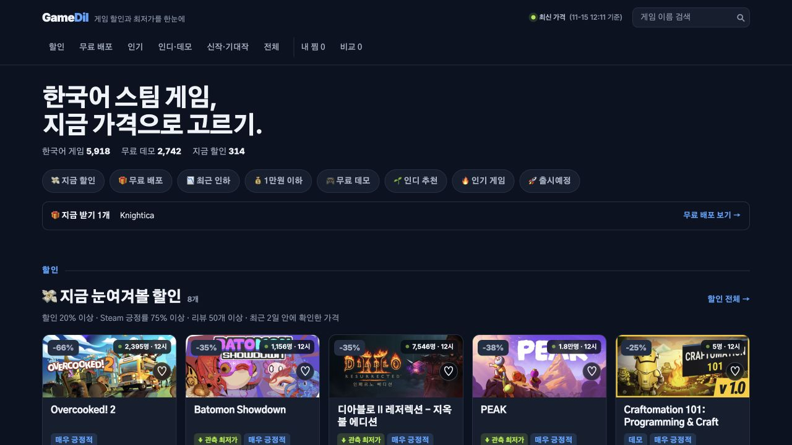
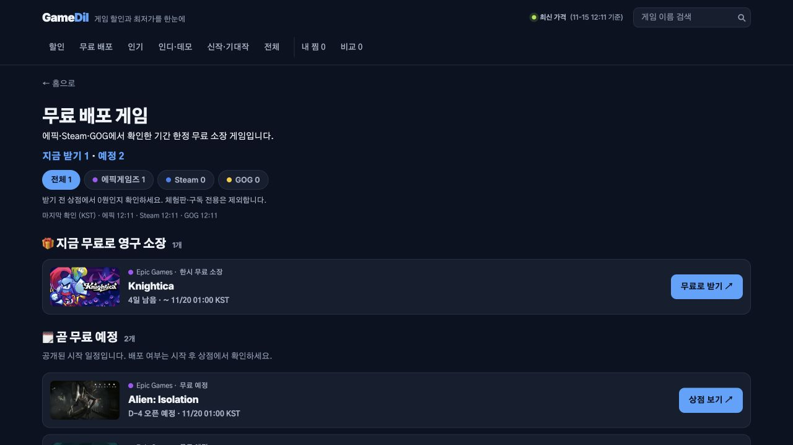
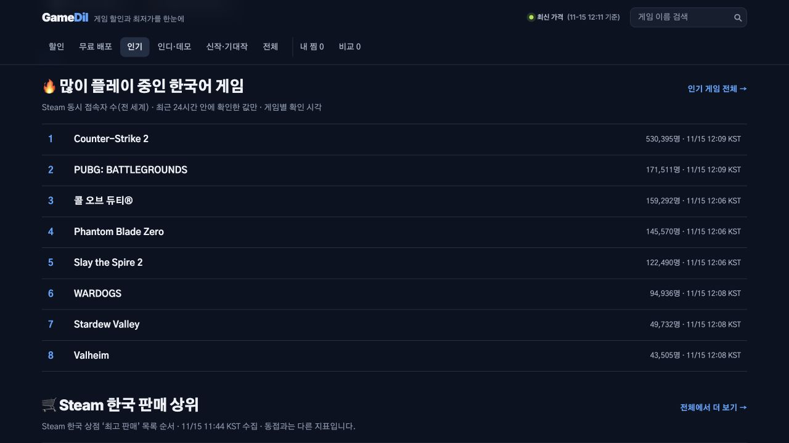
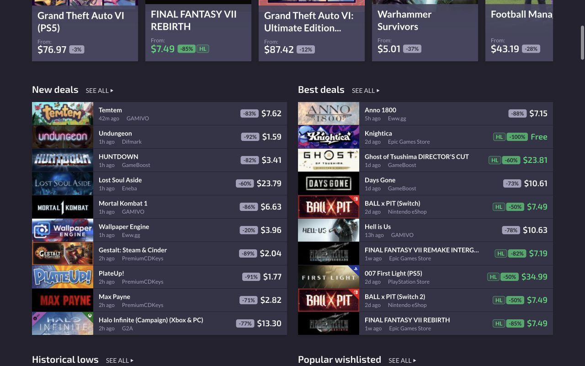
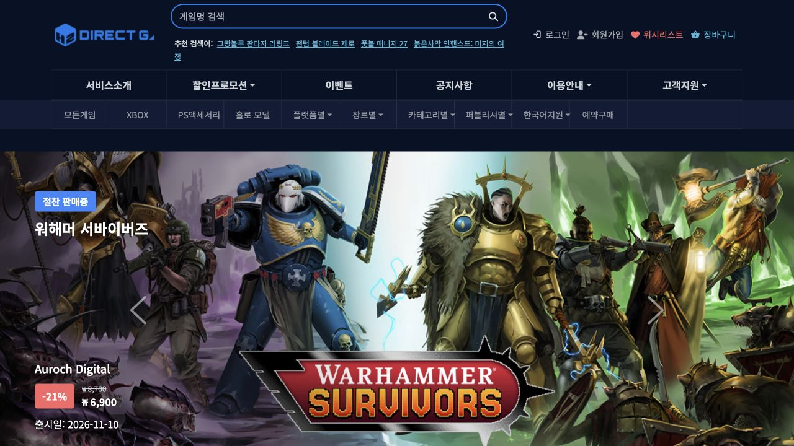
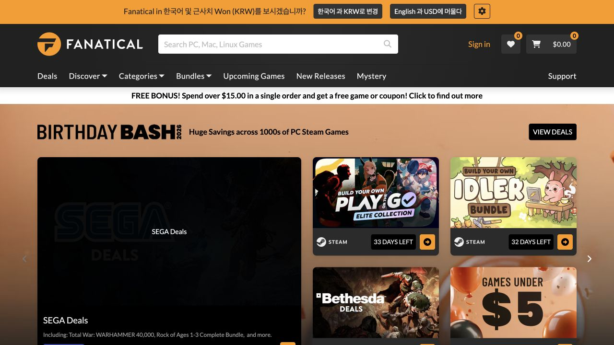
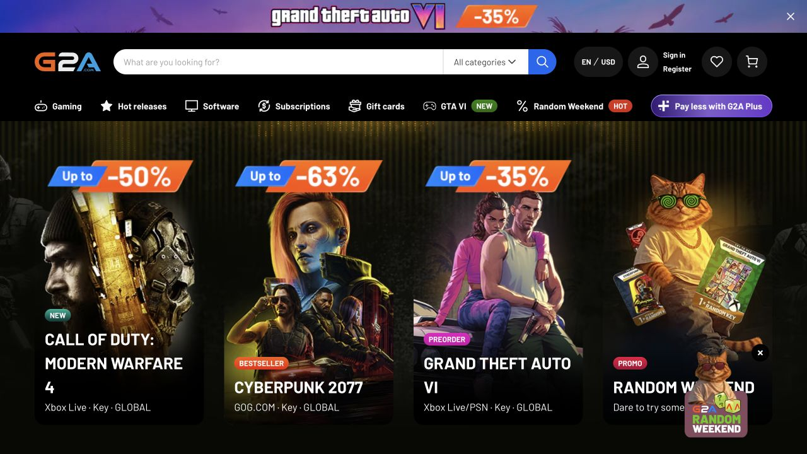
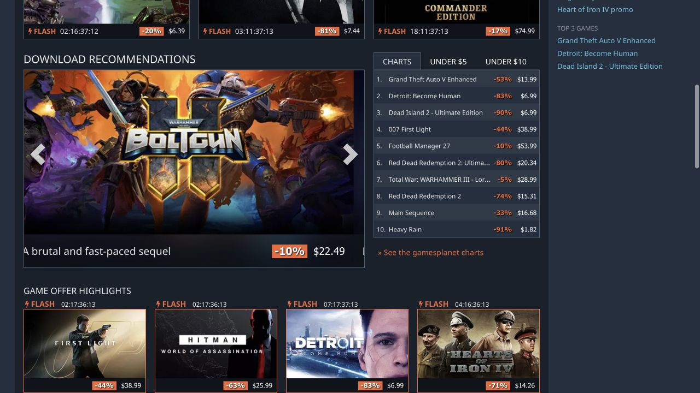

# GameDil 이미지·밀도 참고 검토 — 2026-11-15
- 범위: 현 공개 홈/무료 페이지와 사용자 지정 5개 사이트를 같은 세션에서 브라우저로 확인. 최종 비교 캡처는 1280×720. 초기 좁은 화면 캡처는 교체했다.
- 결론: 텍스트만 남기는 축약은 게임 식별과 탐색 매력을 약화시킨다. 작은 표지 + 정보 묶음 + 적정 너비가 필요하며, 작은 표지만 추가하면 가운데 공백은 남는다.
- 이전 의견 보정: 4+4 접기를 일괄 권장하기 전에 섹션 폭·카드 유형을 정리해야 한다. 기존 일반 카드의 판단 정보는 삭제하지 않는다.
1. GameDil 홈 — 개선 필요: 큰 소개 오른쪽과 무료 링크 띠 가운데가 비고, 첫 할인 카드 가격은 첫 화면 아래. 소개를 짧게 하고 오른쪽에 이미지 있는 현재 무료 카드 배치 권장.

2. GameDil 무료 — 개선 필요: 이미지/제목과 오른쪽 버튼 사이가 크게 비고, 화면상 설명·정가·한국어 판단 정보가 보이지 않음. 현재 카드와 예정 목록을 분리된 두 열로 구성 권장.

3. GameDil 인기 순위 — 개선 필요: 이미지 없는 전체 폭 행, 제목과 동접 수치의 큰 간격. 인기/한국 판매 순위를 각각 반폭 패널로 나란히 두고 작은 표지 포함 8행 유지 권장.

4. [GG.deals](https://gg.deals/) — 참고 적합: New deals/Best deals를 나란히 놓고 작은 가로 표지·제목·상점·할인/가격을 행 안에 모음. 큰 표지 영역과 작은 목록을 혼합. 상단 광고는 차용하지 않음.

5. [DirectG](https://directg.net/) — 부분 참고: 큰 게임 이미지와 원화 가격/할인 강조는 명확하나 대형 히어로·광고가 탐색을 아래로 밀어 GameDil 첫 화면 목표에는 부적합.

6. [Fanatical](https://www.fanatical.com/en/) — 부분 참고: 큰 주목 영역과 작은 프로모션을 옆에 배치하는 구성은 유용. 프로모션 밀도·배너 자체는 복제하지 않음. 쿠키 패널 닫은 상태 캡처.

7. [G2A](https://www.g2a.com/) — 부분 참고: 이미지 위계·할인 강조는 강함. 큰 프로모션 타일과 배너/팝업은 빠른 한국어 게임 비교 목적에는 과함.

8. [Gamesplanet](https://us.gamesplanet.com/) — 부분 참고: 큰 추천과 좁은 가격 순위를 함께 배치함. 텍스트 목록이 좁은 칸 안에서는 유효하다는 사례. 촘촘한 작은 글씨는 차용하지 않음.

## 제안하는 배치 (검증 전 설계값)
- 홈 상단: 짧은 소개/통계/바로가기 약 60% + 무료 배포 이미지 카드 약 40%. 현재 게임 표지·가격·마감·CTA, 예정 건수/링크 포함. 무료 배포가 없으면 해당 카드 공간 제거.
- 핫딜: 전체 폭, 4열 카드로 주요 판단 정보 유지. 첫 화면 목표는 카드 가격까지로 잡되 실제 검증 필요. 8장 유지와 4+4 접힘은 별도 결정.
- 인기/판매: 2개 반폭 패널, 각각 순위 + 96×54 안팎 표지 + 제목/보조정보 + 관련 수치. 8행 기본 표시 제안. 모바일 세로 배치.
- 인디/데모: 표지와 선정 근거가 필요한 발견 영역이므로 일반 이미지 카드 유지. 무조건 순위 목록으로 바꾸지 않음.
- 출시예정: 작은 표지 + 제목/장르/한국어 + 출시일. 폭이 남으면 관련 신작 영역과 조합하되 상세 판단 정보를 숨기는 축약은 별도 동의 필요.
- 무료 전용 페이지: 현재 1건은 좌측 약 60~65% 상세 가로 카드, 우측 약 35~40% 예정 카드 목록. 현재 표지 폭 200~240px, 예정 표지 96~120px를 출발점으로 내용에 맞춰 조정.
- 무료 카드는 상점 색/표기, 한국어, 확인된 리뷰/설명, 정가→0원, 마감, CTA를 묶는다. 없는 정보는 생성하지 않으며 예정작은 미래 무료 일정임을 분리 표시.
- 현재 2건이면 좌측에 두 카드 또는 별도 그리드, 현재 0건이면 예정 영역 확장. 종료/오픈에 따른 재배치는 후속 구현 범위.
- 접근성 관찰 한계: 작은 텍스트·이미지 위 글자의 가독성 위험만 시각적으로 확인. 대비 수치, 키보드, 스크린리더, 모바일, 전환율은 검증하지 않음. hover 전용 정보 노출은 권장하지 않음.
- 수정 범위: 본 보고서와 캡처만 추가. 제품 코드·DB·배포·Threads 변경 없음. 기존 미커밋 문서 보존.
